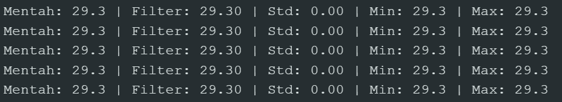
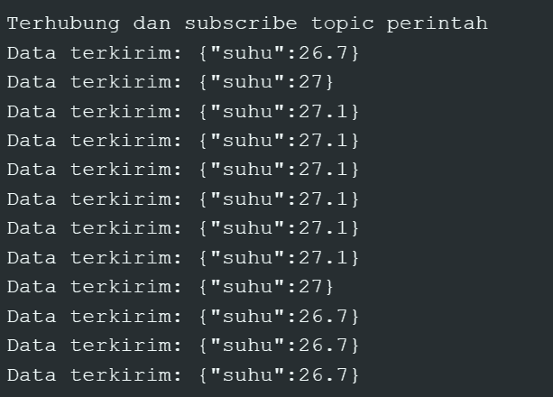
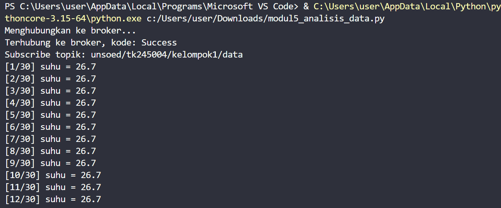
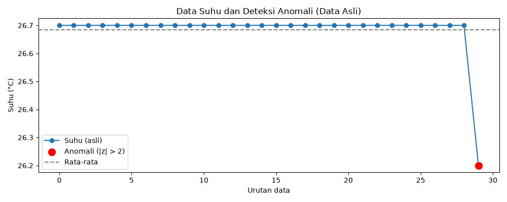

# Pertemuan 5: Pengolahan dan Analisis Data

## Dokumentasi Percobaan 5A


_Gambar 5.1. Serial Monitor saat Percobaan 5A_

## Library yang Diperlukan

### Arduino IDE

- `ESP8266WiFi.h`
- `ArduinoJson.h`
- `PubSubClient.h`
- `DHT.h`

### Python

- `matplotlib`
- `pandas`
- `paho-mqtt` (Eclipse Paho MQTT)

## Percobaan 5A: Pengolahan Data Sensor pada ESP8266 (Moving Average dan Statistik)

Percobaan ini mengambil data suhu dari sensor, kemudian mengolahnya menggunakan moving average dan statistik dasar.

### Program ESP8266

```C++
#include <DHT.h>

#define DHTPIN 4          // D2 = GPIO4 pada NodeMCU
#define DHTTYPE DHT11     // gunakan DHT11

DHT dht(DHTPIN, DHTTYPE);

const int N = 5;          // ukuran jendela moving average
float buffer[N];          // buffer data suhu
int indeks = 0;
int jumlah = 0;

float suhuMin = 1000.0;
float suhuMax = -1000.0;

// Menghitung moving average
float hitungMovingAverage(float nilaiBaru) {
  buffer[indeks] = nilaiBaru;
  indeks = (indeks + 1) % N;
  if (jumlah < N) jumlah++;

  float total = 0;
  for (int i = 0; i < jumlah; i++) {
    total += buffer[i];
  }
  return total / jumlah;
}

// Menghitung simpangan baku (populasi) dari buffer
float hitungSimpanganBaku(float rataRata) {
  float jumlahKuadrat = 0.0;
  for (int i = 0; i < jumlah; i++) {
    float selisih = buffer[i] - rataRata;
    jumlahKuadrat += selisih * selisih;
  }
  if (jumlah <= 1) return 0.0;
  return sqrt(jumlahKuadrat / jumlah);
}

void setup() {
  Serial.begin(115200);
  dht.begin();
  Serial.println("Percobaan 5A - ESP8266 + DHT11");
}

void loop() {
  float suhu = dht.readTemperature();

  if (isnan(suhu)) {
    Serial.println("Pembacaan gagal, data diabaikan");
  } else {
    float suhuFilter = hitungMovingAverage(suhu);
    float simpangan  = hitungSimpanganBaku(suhuFilter);

    if (suhu < suhuMin) suhuMin = suhu;
    if (suhu > suhuMax) suhuMax = suhu;

    Serial.print("Mentah: ");
    Serial.print(suhu, 1);
    Serial.print(" | Filter: ");
    Serial.print(suhuFilter, 2);
    Serial.print(" | Std: ");
    Serial.print(simpangan, 2);
    Serial.print(" | Min: ");
    Serial.print(suhuMin, 1);
    Serial.print(" | Max: ");
    Serial.println(suhuMax, 1);
  }

  delay(2000);  // DHT11 minimal 1 detik, aman 2 detik
}
```

### Modifikasi Program untuk Pertanyaan 5A

```C++
#include <DHT.h>
#define DHTPIN 4
#define DHTTYPE DHT11

DHT dht(DHTPIN, DHTTYPE);

const int N = 5;              // jumlah sampel moving average
float buffer[N];              // menyimpan N pembacaan terakhir
int indeks = 0;               // posisi penulisan berikutnya pada buffer
int jumlah = 0;               // jumlah sampel yang sudah terisi

float suhuMin = 1000.0;
float suhuMax = -1000.0;

// Fungsi untuk menghitung moving average
float hitungMovingAverage(float nilaiBaru) {
  buffer[indeks] = nilaiBaru;
  indeks = (indeks + 1) % N;
  if (jumlah < N) jumlah++;

  float total = 0;
  for (int i = 0; i < jumlah; i++) {
    total += buffer[i];
  }
  return total / jumlah;
}

// TAMBAHAN: fungsi untuk menghitung simpangan baku data buffer
float hitungSimpanganBaku() {
  if (jumlah == 0) return 0.0;       // mencegah pembagian dengan nol

  float total = 0.0;                 // menyimpan jumlah seluruh data
  for (int i = 0; i < jumlah; i++) { // menelusuri data yang terisi
    total += buffer[i];              // menjumlahkan data buffer
  }

  float rataRata = total / jumlah;   // menghitung rata-rata buffer
  float jumlahKuadrat = 0.0;         // menyimpan total kuadrat selisih

  for (int i = 0; i < jumlah; i++) { // menelusuri data buffer kembali
    float selisih = buffer[i] - rataRata; // selisih data dengan rata-rata
    jumlahKuadrat += selisih * selisih;   // menjumlahkan kuadrat selisih
  }

  float varians = jumlahKuadrat / jumlah; // menghitung varians populasi
  return sqrt(varians);                   // akar varians adalah simpangan baku
}

void setup() {
  Serial.begin(115200);
  dht.begin();
}

void loop() {
  float suhu = dht.readTemperature();

  if (isnan(suhu)) {
    Serial.println("Pembacaan gagal, data diabaikan");
  } else {
    float suhuFilter = hitungMovingAverage(suhu);
    float simpanganBaku = hitungSimpanganBaku(); // mod: menghitung simpangan baku buffer

    if (suhu < suhuMin) suhuMin = suhu;
    if (suhu > suhuMax) suhuMax = suhu;

    Serial.print("Mentah: ");
    Serial.print(suhu);
    Serial.print(" | Filter: ");
    Serial.print(suhuFilter);
    Serial.print(" | Simpangan Baku: "); // mod: label output simpangan baku
    Serial.print(simpanganBaku);         // mod: menampilkan simpangan baku
    Serial.print(" | Min: ");
    Serial.print(suhuMin);
    Serial.print(" | Max: ");
    Serial.println(suhuMax);
  }

  delay(2000);
}
```

## Percobaan 5B: Akuisisi, Analisis, dan Visualisasi Data

Percobaan ini mencakup akuisisi data melalui MQTT, analisis statistik dengan Python, serta visualisasi suhu dan anomali.

## Dokumentasi Percobaan 5B



_Gambar 5.2. Serial Monitor ESP8266 menampilkan data suhu DHT11 dalam format JSON yang dikirim ke broker MQTT._



_Gambar 5.3. Terminal Python terhubung ke broker MQTT dan menerima data suhu hingga 12 dari 30 sampel._


_Gambar 5.4. Terminal Python menampilkan ringkasan 30 sampel: rata-rata 27,03 °C, simpangan baku 0,25, suhu minimum 26,70 °C, suhu maksimum 27,60 °C, dan 2 anomali._



_Gambar 5.5. Grafik 30 sampel suhu asli; titik merah menandai data yang terdeteksi sebagai anomali menggunakan metode Z-score._

### Program ESP8266

```C++
#include <ESP8266WiFi.h>    // Library untuk koneksi WiFi
#include <PubSubClient.h>   // Library untuk komunikasi MQTT
#include <ArduinoJson.h>    // Library untuk JSON
#include <DHT.h>            // Library untuk sensor DHT
// ==================== KONFIGURASI WIFI ====================
const char* ssid = "GANTI_DENGAN_SSID_WIFI";       // Ganti dengan SSID WiFi Anda
const char* password = "GANTI_DENGAN_PASSWORD";    // Ganti dengan password WiFi Anda
// ==================== KONFIGURASI MQTT ====================
const char* mqttServer = "broker.hivemq.com";  // Broker MQTT publik
const int mqttPort = 1883;                      // Port MQTT standar
const char* topicData = "unsoed/tk245004/kelompok1/data";        // Topic untuk publish data sensor
const char* topicPerintah = "unsoed/tk245004/kelompok1/perintah"; // Topic untuk subscribe perintah
// ==================== KONFIGURASI SENSOR DHT ====================
#define DHTPIN 5        // GPIO 5 untuk sensor DHT
#define DHTTYPE DHT11   // Tipe sensor DHT11
// ==================== KONFIGURASI PIN ====================
const int ledPin = 4;  // GPIO 4 untuk LED
// ==================== OBJEK GLOBAL ====================
DHT dht(DHTPIN, DHTTYPE);       // Objek sensor DHT
WiFiClient espClient;           // Objek client WiFi
PubSubClient client(espClient); // Objek client MQTT
// ==================== VARIABEL NON-BLOCKING ====================
unsigned long waktuTerakhirPublish = 0;     // Menyimpan waktu terakhir publish
const long intervalPublish = 5000;          // Interval publish 5 detik
// ==================== FUNGSI CALLBACK ====================
// Dipanggil otomatis saat ada pesan masuk pada topic yang di-subscribe
void callback(char* topic, byte* payload, unsigned int length) {
    String pesan;
    // Konversi payload byte array ke String
    for (unsigned int i = 0; i < length; i++) {
        pesan += (char)payload[i];
    }
    // Parsing JSON
    JsonDocument doc;
    if (deserializeJson(doc, pesan)) return;  // Abaikan jika parsing gagal
    // Ambil nilai perintah
    const char* perintah = doc["perintah"];
    // Kontrol LED berdasarkan perintah
    digitalWrite(ledPin, String(perintah) == "ON" ? HIGH : LOW);
    Serial.println("Perintah diterima -> Aktuator: ");
    Serial.println(perintah);
}
// ==================== FUNGSI KONEKSI WIFI ====================
void hubungkanWiFi() {
    WiFi.begin(ssid, password);
    // Tunggu sampai terhubung
    while (WiFi.status() != WL_CONNECTED) {
        delay(500);
    }
    Serial.println("WiFi berhasil terhubung!");
}
// ==================== FUNGSI KONEKSI MQTT ====================
void hubungkanMQTT() {
    // Loop sampai berhasil terhubung
    while (!client.connected()) {
        // Buat client ID unik
        String clientId = "ESP32Client-" + String(random(0xffff), HEX);
        if (client.connect(clientId.c_str())) {
            // Subscribe ke topic perintah
            client.subscribe(topicPerintah);
            Serial.println("Terhubung dan subscribe topic perintah");
        } else {
            delay(2000);  // Tunggu 2 detik sebelum coba lagi
        }
    }
}
// ==================== SETUP ====================
void setup() {
    Serial.begin(115200);       // Inisialisasi Serial Monitor
    pinMode(ledPin, OUTPUT);    // Set GPIO 26 sebagai output
    dht.begin();                // Inisialisasi sensor DHT
    hubungkanWiFi();            // Hubungkan ke WiFi
    client.setServer(mqttServer, mqttPort);  // Set alamat broker MQTT
    client.setCallback(callback);            // Daftarkan fungsi callback
}
// ==================== LOOP ====================
void loop() {
    // Cek koneksi MQTT, sambungkan ulang jika terputus
    if (!client.connected()) hubungkanMQTT();
    // Memproses pesan masuk secara terus-menerus (non-blocking)
    client.loop();
    // ==================== PUBLISH DATA SENSOR (NON-BLOCKING) ====================
    // Cek apakah sudah waktunya publish berdasarkan millis()
    if (millis() - waktuTerakhirPublish > intervalPublish) {
        waktuTerakhirPublish = millis();  // Update waktu terakhir publish
        // Baca suhu dari sensor DHT
        float suhu = dht.readTemperature();
        // Cek apakah pembacaan valid (bukan NaN)
        if (!isnan(suhu)) {
            // Buat JSON document
            JsonDocument doc;
            doc["suhu"] = suhu;
            // Serialisasi JSON ke buffer
            char buffer[128];
            serializeJson(doc, buffer);
            // Publish ke topic data
            client.publish(topicData, buffer);
            Serial.print("Data terkirim: ");
            Serial.println(buffer);
        }
    }
}
```

### Skrip Python

```py
# ============================================================
# Modul 5 - Percobaan 5B
# MQTT Subscriber + CSV + Statistik + Z-Score + MA5 + Grafik
# Board  : ESP8266 + DHT11
# ============================================================

import json
import time
import paho.mqtt.client as mqtt
import pandas as pd
import matplotlib.pyplot as plt

# ---------------- KONFIGURASI ----------------
BROKER        = "broker.hivemq.com"
PORT          = 1883
TOPIC         = "unsoed/tk245004/kelompok1/data"   # ← SAMAKAN dengan topicData ESP8266
JUMLAH_SAMPEL = 30
# ---------------------------------------------

data = []

# ---------- CALLBACK ----------
def on_connect(client, userdata, flags, reason_code, properties):
    print("Terhubung ke broker, kode:", reason_code)
    client.subscribe(TOPIC)
    print("Subscribe topik:", TOPIC)

def on_message(client, userdata, msg):
    try:
        payload = json.loads(msg.payload.decode())
        suhu    = float(payload["suhu"])
    except (ValueError, KeyError):
        print("Data tidak valid, diabaikan")
        return

    waktu = time.strftime("%Y-%m-%d %H:%M:%S")
    data.append({"waktu": waktu, "suhu": suhu})
    print(f"[{len(data)}/{JUMLAH_SAMPEL}] suhu = {suhu}")

    if len(data) >= JUMLAH_SAMPEL:
        print("Jumlah sampel terpenuhi, memutus koneksi...")
        client.disconnect()

# ---------- TAHAP 1: AKUISISI MQTT ----------
print("Menghubungkan ke broker...")
client = mqtt.Client(mqtt.CallbackAPIVersion.VERSION2)
client.on_connect = on_connect
client.on_message = on_message
client.connect(BROKER, PORT)
client.loop_forever()

# ---------- TAHAP 2: SIMPAN CSV AWAL ----------
df = pd.DataFrame(data)
df.to_csv("data_suhu.csv", index=False)
print("Data tersimpan di data_suhu.csv")

# ---------- TAHAP 3: STATISTIK + Z-SCORE (DATA ASLI) ----------
rata2 = df["suhu"].mean()
std   = df["suhu"].std()

if std == 0:
    df["zscore"] = 0.0
else:
    df["zscore"] = (df["suhu"] - rata2) / std

df["anomali"] = df["zscore"].abs() > 2

print("\n=== Statistik Data Asli ===")
print(f"Rata-rata     : {rata2:.2f}")
print(f"Std deviasi   : {std:.2f}")
print(f"Minimum       : {df['suhu'].min():.2f}")
print(f"Maksimum      : {df['suhu'].max():.2f}")
print(f"Jumlah anomali: {df['anomali'].sum()}")

# ---------- TAHAP 3B: MA5 SEBELUM Z-SCORE (TUGAS TAMBAHAN) ----------
df["suhu_ma5"] = df["suhu"].rolling(window=5, min_periods=1).mean()

rata2_ma = df["suhu_ma5"].mean()
std_ma   = df["suhu_ma5"].std()

if std_ma == 0:
    df["zscore_ma"] = 0.0
else:
    df["zscore_ma"] = (df["suhu_ma5"] - rata2_ma) / std_ma

df["anomali_ma"] = df["zscore_ma"].abs() > 2

print("\n=== Statistik Setelah Moving Average 5 ===")
print(f"Rata-rata MA5     : {rata2_ma:.2f}")
print(f"Std deviasi MA5   : {std_ma:.2f}")
print(f"Jumlah anomali MA5: {df['anomali_ma'].sum()}")
print(f"Perbandingan      : asli = {df['anomali'].sum()} | MA5 = {df['anomali_ma'].sum()}")

# ---------- TAHAP 3C: TAMPILKAN Z-SCORE TIAP DATA DI TERMINAL ----------
print("\n=== Z-Score Tiap Data (Data Asli) ===")
print(df[["waktu", "suhu", "zscore", "anomali"]].to_string(index=False))

print("\n=== Data yang Terdeteksi Anomali (|z| > 2) ===")
anomali_only = df[df["anomali"]][["waktu", "suhu", "zscore"]]
if len(anomali_only) == 0:
    print("(Tidak ada anomali terdeteksi)")
else:
    print(anomali_only.to_string(index=False))

print("\n=== Z-Score Tiap Data Setelah MA5 ===")
print(df[["waktu", "suhu_ma5", "zscore_ma", "anomali_ma"]].to_string(index=False))

# ---------- TAHAP 4: GRAFIK DATA ASLI ----------
plt.figure(figsize=(10, 4))
plt.plot(df.index, df["suhu"], marker="o", label="Suhu (asli)")

anom = df[df["anomali"]]
plt.scatter(anom.index, anom["suhu"], color="red", s=100,
            label="Anomali (|z| > 2)", zorder=3)

plt.axhline(rata2, color="gray", linestyle="--", label="Rata-rata")
plt.xlabel("Urutan data")
plt.ylabel("Suhu (°C)")
plt.title("Data Suhu dan Deteksi Anomali (Data Asli)")
plt.legend()
plt.tight_layout()
plt.savefig("grafik_suhu.png")
print("\nGrafik disimpan: grafik_suhu.png")
plt.show()

# ---------- TAHAP 5: GRAFIK SETELAH MA5 ----------
plt.figure(figsize=(10, 4))
plt.plot(df.index, df["suhu"],     marker="o", color="lightblue",
         alpha=0.6, label="Suhu (asli)")
plt.plot(df.index, df["suhu_ma5"], marker="o", color="blue",
         label="Suhu MA5")

anom_ma = df[df["anomali_ma"]]
plt.scatter(anom_ma.index, anom_ma["suhu_ma5"], color="orange", s=100,
            label="Anomali MA5 (|z| > 2)", zorder=3)

plt.axhline(rata2_ma, color="gray", linestyle="--", label="Rata-rata MA5")
plt.xlabel("Urutan data")
plt.ylabel("Suhu (°C)")
plt.title("Data Suhu Setelah Moving Average 5 dan Deteksi Anomali")
plt.legend()
plt.tight_layout()
plt.savefig("grafik_suhu_ma5.png")
print("Grafik disimpan: grafik_suhu_ma5.png")
plt.show()

# ---------- TAHAP 6: SIMPAN CSV LENGKAP ----------
df.to_csv("data_suhu.csv", index=False)
print("CSV lengkap (dengan kolom z-score & MA5) tersimpan di data_suhu.csv")
print("Selesai.")
```

### Modifikasi Program Python untuk Pertanyaan 5B

```py
import json
import time
import paho.mqtt.client as mqtt
import pandas as pd
import matplotlib.pyplot as plt

# ---------------- KONFIGURASI ----------------
BROKER        = "broker.hivemq.com"
PORT          = 1883
TOPIC         = "unsoed/tk245004/kelompok1/data"   # ← SAMAKAN dengan topicData ESP8266
JUMLAH_SAMPEL = 30
# ---------------------------------------------

data = []

# ---------- CALLBACK ----------
def on_connect(client, userdata, flags, reason_code, properties):
    print("Terhubung ke broker, kode:", reason_code)
    client.subscribe(TOPIC)
    print("Subscribe topik:", TOPIC)

def on_message(client, userdata, msg):
    try:
        payload = json.loads(msg.payload.decode())
        suhu    = float(payload["suhu"])
    except (ValueError, KeyError):
        print("Data tidak valid, diabaikan")
        return

    waktu = time.strftime("%Y-%m-%d %H:%M:%S")
    data.append({"waktu": waktu, "suhu": suhu})
    print(f"[{len(data)}/{JUMLAH_SAMPEL}] suhu = {suhu}")

    if len(data) >= JUMLAH_SAMPEL:
        print("Jumlah sampel terpenuhi, memutus koneksi...")
        client.disconnect()

# ---------- TAHAP 1: AKUISISI MQTT ----------
print("Menghubungkan ke broker...")
client = mqtt.Client(mqtt.CallbackAPIVersion.VERSION2)
client.on_connect = on_connect
client.on_message = on_message
client.connect(BROKER, PORT)
client.loop_forever()

# ---------- TAHAP 2: SIMPAN CSV AWAL ----------
df = pd.DataFrame(data)
df.to_csv("data_suhu.csv", index=False)
print("Data tersimpan di data_suhu.csv")
df = pd.read_csv("data_suhu.csv")  # Membaca data dari CSV sebagai sumber analisis berikutnya.
df["suhu_ma5"] = df["suhu"].rolling(window=5, min_periods=1).mean()  # Menghitung MA5 terlebih dahulu dari data CSV.

# ---------- TAHAP 3: STATISTIK + Z-SCORE (DATA ASLI UNTUK PEMBANDING) ----------
rata2 = df["suhu"].mean()
std   = df["suhu"].std()

if std == 0:
    df["zscore"] = 0.0
else:
    df["zscore"] = (df["suhu"] - rata2) / std

df["anomali"] = df["zscore"].abs() > 2

print("\n=== Statistik Data Asli ===")
print(f"Rata-rata     : {rata2:.2f}")
print(f"Std deviasi   : {std:.2f}")
print(f"Minimum       : {df['suhu'].min():.2f}")
print(f"Maksimum      : {df['suhu'].max():.2f}")
print(f"Jumlah anomali: {df['anomali'].sum()}")

# ---------- TAHAP 3B: Z-SCORE PADA DATA HASIL MA5 ----------
rata2_ma = df["suhu_ma5"].mean()  # Menghitung rata-rata dari hasil MA5.
std_ma = df["suhu_ma5"].std()  # Menghitung simpangan baku hasil MA5.

if std_ma == 0:  # Memeriksa apakah semua nilai MA5 sama.
    df["zscore_ma"] = 0.0  # Menghindari pembagian dengan nol.
else:  # Dilakukan jika simpangan baku MA5 tidak nol.
    df["zscore_ma"] = (df["suhu_ma5"] - rata2_ma) / std_ma  # Menghitung z-score dari nilai MA5.

df["anomali_ma"] = df["zscore_ma"].abs() > 2  # Menandai MA5 sebagai anomali jika |z| > 2.
jumlah_anomali_asli = int(df["anomali"].sum())  # Menghitung anomali pada data suhu asli.
jumlah_anomali_ma5 = int(df["anomali_ma"].sum())  # Menghitung anomali setelah MA5.
selisih_anomali = jumlah_anomali_asli - jumlah_anomali_ma5  # Membandingkan jumlah anomali sebelum dan sesudah MA5.

print("\n=== Statistik Setelah Moving Average 5 ===")  # Menampilkan judul ringkasan hasil MA5.
print(f"Rata-rata MA5     : {rata2_ma:.2f}")  # Menampilkan rata-rata hasil MA5.
print(f"Std deviasi MA5   : {std_ma:.2f}")  # Menampilkan simpangan baku hasil MA5.
print(f"Jumlah anomali asli: {jumlah_anomali_asli}")  # Menampilkan jumlah anomali data asli.
print(f"Jumlah anomali MA5 : {jumlah_anomali_ma5}")  # Menampilkan jumlah anomali hasil MA5.
print(f"Selisih (asli-MA5) : {selisih_anomali}")  # Positif berarti MA5 mendeteksi lebih sedikit anomali.

# ---------- TAHAP 3C: TAMPILKAN Z-SCORE TIAP DATA DI TERMINAL ----------
print("\n=== Z-Score Tiap Data (Data Asli) ===")
print(df[["waktu", "suhu", "zscore", "anomali"]].to_string(index=False))

print("\n=== Data yang Terdeteksi Anomali (|z| > 2) ===")
anomali_only = df[df["anomali"]][["waktu", "suhu", "zscore"]]
if len(anomali_only) == 0:
    print("(Tidak ada anomali terdeteksi)")
else:
    print(anomali_only.to_string(index=False))

print("\n=== Z-Score Tiap Data Setelah MA5 ===")  # Menampilkan judul tabel hasil deteksi setelah MA5.
print(df[["waktu", "suhu_ma5", "zscore_ma", "anomali_ma"]].to_string(index=False))  # Menampilkan waktu, MA5, z-score, dan status anomali.

# ---------- TAHAP 4: GRAFIK DATA ASLI ----------
plt.figure(figsize=(10, 4))
plt.plot(df.index, df["suhu"], marker="o", label="Suhu (asli)")

anom = df[df["anomali"]]
plt.scatter(anom.index, anom["suhu"], color="red", s=100,
            label="Anomali (|z| > 2)", zorder=3)

plt.axhline(rata2, color="gray", linestyle="--", label="Rata-rata")
plt.xlabel("Urutan data")
plt.ylabel("Suhu (°C)")
plt.title("Data Suhu dan Deteksi Anomali (Data Asli)")
plt.legend()
plt.tight_layout()
plt.savefig("grafik_suhu.png")
print("\nGrafik disimpan: grafik_suhu.png")
plt.show()

# ---------- TAHAP 5: GRAFIK SETELAH MA5 ----------
plt.figure(figsize=(10, 4))  # Membuat kanvas grafik MA5.
plt.plot(df.index, df["suhu"], marker="o", color="lightblue", alpha=0.6, label="Suhu (asli)")  # Menampilkan suhu asli sebagai pembanding.
plt.plot(df.index, df["suhu_ma5"], marker="o", color="blue", label="Suhu MA5")  # Menampilkan garis hasil moving average.
anom_ma = df[df["anomali_ma"]]  # Memilih baris yang terdeteksi anomali setelah MA5.
plt.scatter(anom_ma.index, anom_ma["suhu_ma5"], color="orange", s=100, label="Anomali MA5 (|z| > 2)", zorder=3)  # Menandai anomali MA5.
plt.axhline(rata2_ma, color="gray", linestyle="--", label="Rata-rata MA5")  # Menambahkan garis rata-rata MA5.
plt.xlabel("Urutan data")  # Memberi label sumbu horizontal.
plt.ylabel("Suhu (°C)")  # Memberi label sumbu vertikal.
plt.title("Data Suhu Setelah Moving Average 5 dan Deteksi Anomali")  # Memberi judul grafik MA5.
plt.legend()  # Menampilkan keterangan garis dan titik.
plt.tight_layout()  # Merapikan jarak antarelemen grafik.
plt.savefig("grafik_suhu_ma5.png")  # Menyimpan grafik hasil MA5 ke file PNG.
print("Grafik disimpan: grafik_suhu_ma5.png")  # Menampilkan nama file grafik yang disimpan.
plt.show()  # Menampilkan grafik MA5 di layar.

# ---------- TAHAP 6: SIMPAN CSV LENGKAP ----------
df.to_csv("data_suhu.csv", index=False)
print("CSV lengkap (dengan kolom z-score & MA5) tersimpan di data_suhu.csv")  # Mengonfirmasi bahwa hasil statistik dan MA5 telah disimpan.
print("Selesai.")
```
